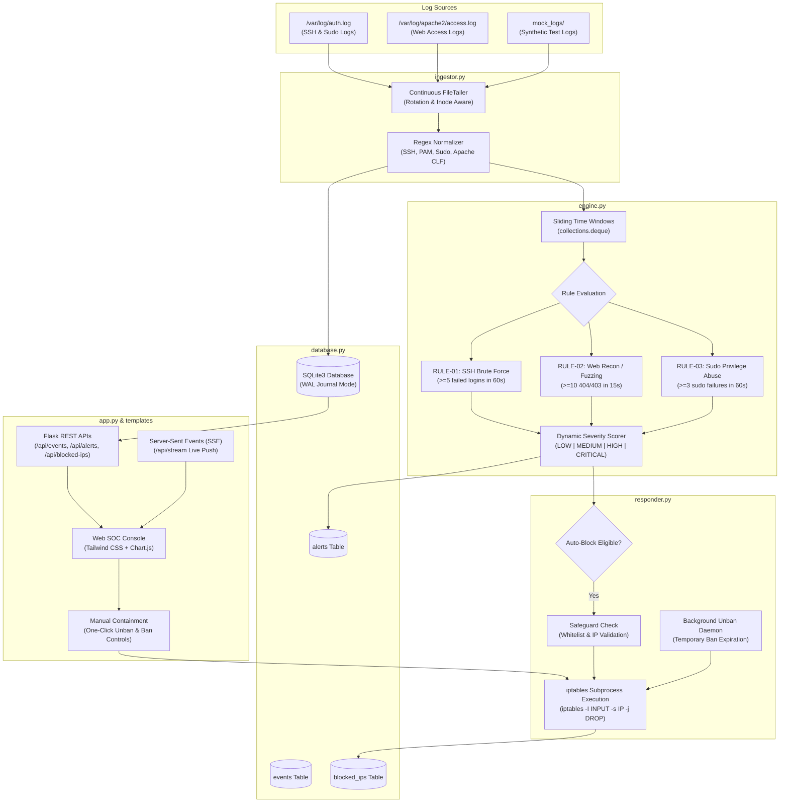

# PySIEM-Lite 🛡️
### *Lightweight Autonomous Host-Based SIEM & Active Defense Engine for Kali Linux*

PySIEM-Lite is an end-to-end, high-performance, modular Security Information and Event Management (SIEM) system built from scratch in Python. It is engineered specifically for security practitioners, SOC analysts, and academic demonstrations on Kali Linux where heavyweight platforms like Splunk, Wazuh, or Elastic SIEM are too resource-intensive.

PySIEM-Lite continuously monitors Linux system and web server logs, parses and standardizes disparate syslog formats into structured JSON events, applies a multi-event correlation engine across in-memory sliding time windows, raises prioritized security alerts, and executes active defense mitigations via `iptables` while streaming real-time telemetry to a web-based SOC Analyst Console.

---

## 🏛️ Architecture & Data Flow



---

## 📁 Project Directory Structure

```text
PySIEM-Lite/
├── config.py             # System paths, rule thresholds, severity scores, and IP whitelists
├── database.py           # SQLite schema setup, thread-safe connection pooling, WAL mode, query helpers
├── ingestor.py           # Multi-threaded file tailer, regex normalizer, syslog timestamp parser
├── engine.py             # Sliding time-window correlation engine, rule evaluators, dynamic scoring
├── responder.py          # iptables active defense wrapper, whitelist safeguards, auto-unban daemon
├── app.py                # Flask web server, REST APIs, Server-Sent Events (SSE) telemetry stream
├── templates/
│   └── index.html        # Modern SOC Analyst Console UI (Tailwind CSS, Chart.js, Lucide icons)
├── simulate_attacks.sh   # Live attack generation tool for viva demonstrations and verification
├── main.py               # Unified CLI orchestrator launching all system components simultaneously
├── requirements.txt      # Minimal dependencies (Flask)
└── README.md             # Architecture documentation and demonstration manual
```

---

## ⚡ Detection Rules Specification

| Rule ID | Rule Name | Target Event | Threshold | Window | Base Severity | Auto-Mitigation |
| :--- | :--- | :--- | :--- | :--- | :--- | :--- |
| **RULE-01** | SSH Brute Force Attack | `LOGIN_FAILED` | $\ge 5$ attempts | 60 sec | `HIGH` / `CRITICAL` | `iptables -I INPUT -s <IP> -j DROP` |
| **RULE-02** | Web Reconnaissance & Fuzzing | `WEB_REQUEST` ($403/404$) | $\ge 10$ errors | 15 sec | `HIGH` / `CRITICAL` | `iptables -I INPUT -s <IP> -j DROP` |
| **RULE-03** | Suspicious Sudo Abuse | `SUDO_FAILURE` | $\ge 3$ failures | 60 sec | `HIGH` / `CRITICAL` | Host Alert Only (User Level) |

### Dynamic Severity Escalation
- **RULE-01**: Escalates from `HIGH` to `CRITICAL` if authentication attempts target `root` or `admin`, or if attempt volume exceeds $10$ attempts.
- **RULE-02**: Escalates to `CRITICAL` if scanning probes high-value endpoints (`/.env`, `wp-config.php`, `/.git`, `/etc/passwd`, `/admin`) or count exceeds $20$ requests.
- **RULE-03**: Escalates to `CRITICAL` if unauthorized non-sudoers execute root-level commands repeatedly.

---

## 🚀 Step-by-Step Installation & Setup on Kali Linux

### 1. Prerequisites & Environment Setup
Open a terminal on your Kali Linux machine:
```bash
# Update package repositories
sudo apt-get update

# Ensure Python 3, pip, and iptables are present
sudo apt-get install -y python3 python3-pip iptables curl

# Clone or navigate to the PySIEM-Lite directory
cd ~/Desktop/PySIEM-Lite

# Install minimal dependencies
pip3 install -r requirements.txt
```

### 2. Make Scripts Executable
```bash
chmod +x simulate_attacks.sh main.py app.py
```

---

## 🖥️ Running PySIEM-Lite

### Mode A: Standard Full Production Mode (Root Recommended for iptables)
To allow PySIEM-Lite to natively execute `iptables` DROP rules against real network attackers:
```bash
sudo python3 main.py
```
*Outputs:*
- Starts SQLite database engine with WAL journaling.
- Spawns background thread for active defense auto-unban monitor.
- Tails `/var/log/auth.log` and `/var/log/apache2/access.log`.
- Serves the SOC Web Console on `http://0.0.0.0:5000`.

### Mode B: Mock / Demonstration Mode (Safe & Non-Root)
If running in a classroom environment, non-root account, or testing without touching live system logs:
```bash
python3 main.py --mock
```
*Outputs:*
- Automatically uses isolated log files in `./mock_logs/auth.log` and `./mock_logs/access.log`.
- Automatically simulates `iptables` rules without throwing permission errors.

### Mode C: Standalone Web Console Only
```bash
python3 app.py
```

---

## 🎯 Viva & Demonstration Walkthrough

Follow this 5-minute live demonstration script to showcase all SIEM components during evaluations:

### Step 1: Open the SOC Web Console
1. Launch PySIEM-Lite in **Terminal 1**:
   ```bash
   sudo python3 main.py
   ```
2. Open your browser on Kali Linux and navigate to:
   ```text
   http://localhost:5000
   ```
3. Highlight the UI features to your evaluator:
   - **KPI Metric Cards**: Real-time counters for Ingested Events, Security Alerts, Critical Incidents, and Active iptables Drops.
   - **Visual Analytics**: Interactive Chart.js doughnut chart for event distribution and bar chart for rule activity.
   - **Active Defense Blocklist**: Displays contained attacker IPs with timestamps and single-click manual **"Unban IP"** capability.
   - **Live Ingested Event Feed**: Streaming normalized logs with real-time text search and event type filtering.

---

### Step 2: Simulate SSH Brute Force (RULE-01)
1. Open **Terminal 2** and launch the attack simulator:
   ```bash
   ./simulate_attacks.sh
   ```
2. Select Option `1` (or run `./simulate_attacks.sh --ssh`).
3. **What happens under the hood:**
   - 7 rapid failed SSH logins are generated from attacker IP `198.51.100.45` targeting accounts `root`, `admin`, `oracle`.
   - `ingestor.py` normalizes each line into structured `LOGIN_FAILED` events.
   - `engine.py` detects threshold violation ($\ge 5$ events in $60$s) and evaluates root targeting $\rightarrow$ escalates severity to `CRITICAL`.
   - `responder.py` executes: `iptables -I INPUT -s 198.51.100.45 -j DROP`.
4. **Observer on the Dashboard:**
   - A critical red toast notification alerts the analyst.
   - The alert appears instantly in the **Security Alerts Stream**.
   - `198.51.100.45` appears in the **Active Defense Blocklist** table.
   - Verify on Kali terminal via:
     ```bash
     sudo iptables -L INPUT -v -n
     ```

---

### Step 3: Simulate Web Application Reconnaissance (RULE-02)
1. In **Terminal 2**, run:
   ```bash
   ./simulate_attacks.sh --web
   ```
2. **What happens under the hood:**
   - 14 rapid HTTP 404/403 scanning probes (e.g. `/.env`, `/wp-login.php`, `/phpmyadmin`) are generated from attacker IP `203.0.113.89`.
   - `engine.py` detects threshold violation ($\ge 10$ errors in $15$s) and flags sensitive probes $\rightarrow$ raises `CRITICAL` alert.
   - `responder.py` executes: `iptables -I INPUT -s 203.0.113.89 -j DROP`.
3. **Observer on the Dashboard:**
   - An alert appears with sample probed endpoints.
   - Active Defense blocklist updates to show both attacker IPs blocked.

---

### Step 4: Simulate Sudo Privilege Abuse (RULE-03)
1. In **Terminal 2**, run:
   ```bash
   ./simulate_attacks.sh --sudo
   ```
2. **What happens under the hood:**
   - Unauthorized sudo password failures and "user NOT in sudoers" attempts are injected for user `infiltrator_bob`.
   - `engine.py` correlates sudo failures and raises a `HIGH` privilege escalation alert on the console.

---

### Step 5: Test Active Defense Unban & Containment
1. On the web dashboard, locate `198.51.100.45` in the **Active Defense Blocklist**.
2. Click the red **"Unban IP"** button.
3. The dashboard executes a `POST` request to `/api/unblock`.
4. `responder.py` safely removes the rule via `iptables -D INPUT -s 198.51.100.45 -j DROP`.
5. The blocklist and KPI cards update in real-time.
6. Click the top-right **"Manual Ban IP"** button, enter a target IP (e.g. `10.20.30.40`), and click **Execute iptables DROP** to demonstrate manual SOC intervention.

---

## 🛡️ Security Safeguards Built-In

1. **IP Whitelisting & Loopback Protection**: `127.0.0.1`, `::1`, `0.0.0.0`, and loopback addresses are hard-whitelisted to prevent accidental self-lockout of the SOC server.
2. **Alert Storm Cooldown**: In-memory sliding windows feature a 30-second cooldown per rule-entity pair to prevent database flooding during high-velocity DDoS or brute-force floods.
3. **WAL Database Concurrency**: SQLite is initialized in Write-Ahead Logging (`WAL`) mode with `NORMAL` synchronous mode, preventing locking conflicts between simultaneous ingestion threads, the detection engine, and the Flask web server.
4. **Log Rotation Resilience**: File tailers maintain file descriptor inode and offset tracking, seamlessly surviving `logrotate` executions and log file truncations.
5. **Non-Root Graceful Degradation**: If run without root privileges, active defense operations automatically transition into `SIMULATED_BLOCKED` mode without crashing.

---

## 📄 License
Educational & Defensive Security Research under the **MIT License**.
